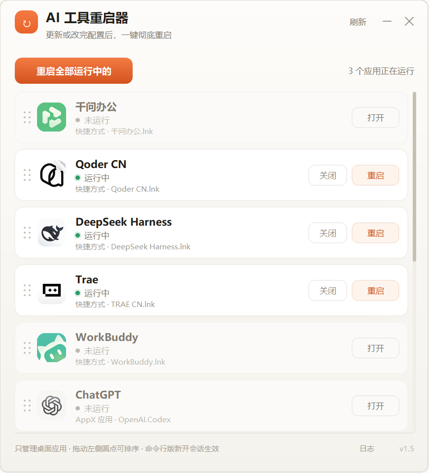

# AI 工具重启器

Windows 小工具：更新或改完配置后，一键彻底重启 AI 编程桌面应用。无边框自绘面板，单实例，可收进系统托盘。

当前版本 **v1.5**（WinForms / .NET Framework 4.8）。只需要 Windows 10/11（.NET Framework 4.8 系统自带），把 `AIRestarter.exe` 放到任意目录双击即可，无需安装。

## 界面

- 暖白底、橙色主操作，一屏一个列表，每行一个应用：图标、名称、状态点、路径来源、右侧操作按钮。
- 运行中的行带投影、标题用主文本色；未运行的行底色收进背景、标题降灰、图标降饱和约 30%，退到后面。
- 行图标用应用自己的图标：`.lnk` 取快捷方式自带的图标位，没有则退回目标 exe；AppX 应用取装包目录里该应用 exe 的内嵌图标；都取不到时退回应用名首字母色块。
- 支持每显示器独立 DPI（PerMonitorV2）：图标按 256px 提取后再按当前 DPI 缩放，200% 屏上不糊。

## 检测与操作

自动检测已安装项，未安装的不显示。运行状态按进程名与安装目录前缀匹配，安装目录取自快捷方式指向的那个 exe，所以装在哪个盘、哪个目录都能认（快捷方式指向 `wscript.exe` 这类系统宿主的除外，那种只当它是包装脚本）。运行中的行给「关闭 / 重启」，未运行的行给「打开」；关闭 = 完全退出进程且不重新打开，重启 = 关闭后再打开；顶部「重启全部运行中的」需要确认。状态每 2.5 秒刷新一次，「刷新」按钮重新扫描安装情况与图标。

按关闭方式分两类：

- **托盘型**（点关闭只收进托盘，必须强制结束整棵进程树）：ChatGPT（AppX 包名 `OpenAI.Codex`）、Claude Desktop、Qoder CN、Qoder、DeepSeek Harness、WorkBuddy、ZCode、千问办公。
- **编辑器型**（先正常关闭；若因保存确认未退出，取消本次重启，不强杀）：Qoder CN IDE、OpenCode、Cursor、Windsurf、Trae、Kiro、Zed、Antigravity。

千问办公是多进程应用（`QwenWorkCN` + `qwenworkhelper`），重启时一起结束再重新拉起。

## 交互

- 排序：按住行左侧的六点圆点拖动，松手即保存。
- 任务栏：点击任务栏按钮在最小化和还原之间切换。
- 关闭面板：点 × 或 Alt+F4 只是**收进系统托盘**，进程继续在后台跑；想彻底退出用托盘右键 →「完全退出」。
- 托盘图标：左键单击 = 打开面板；右键菜单有「打开面板」「重启全部工具」「完全退出」。
- 已收起时再次双击快捷方式会把面板叫回来，不会开出第二个实例。
- 命令行版（Codex CLI / Claude Code）不在范围内，新开会话即生效。

## 环境隔离

从某个 AI 工具的内部终端启动本工具时，`QODER*` / `ELECTRON_*` / `NODE_OPTIONS` / `CLAUDECODE` 会在拉起应用前被清掉。这些变量由宿主终端注入，被重启的应用继承后会认错自己的产品（例如 Qoder 被认成 qoder-cn 而启动失败）。用 `.lnk` 启动时不覆盖 WorkingDirectory，使用快捷方式自身的起始位置。

## 资源占用

- 打开时本机实测约 67MB 私有内存；工作集刚打开约 107MB，稳定后约 20MB
- 最小化时自动收回工作集，任务管理器约 4MB（私有内存仍约 67MB）

## 文件

| 文件 | 内容 |
| --- | --- |
| `AIRestarter.cs` | 全部源码（单文件自绘界面，无 Designer、无子控件） |
| `AIRestarter.exe` | `build.cmd` 的产物，不入库；现成的在 Releases 里下 |
| `app.ico` / `app.manifest` / `build.cmd` | 程序图标、PerMonitorV2 清单声明、编译脚本 |
| `README.md` / `LICENSE` / `docs\screenshot.png` | 本说明、MIT 授权、上面那张面板截图 |

程序自己写的两个文件在 `%LOCALAPPDATA%\AIRestarter\`：`order.txt` 存列表顺序，`log.txt` 是运行日志（只记操作与检测到的应用名/路径，不联网上传）。想挂到开始菜单或任务栏，自己建一个指向 `AIRestarter.exe` 的快捷方式即可。

## 重新编译

运行 `build.cmd`，使用 Windows 自带的 .NET Framework 4.8 编译器，无需安装 SDK。源码引用 `System.Windows.Forms`、`System.Drawing`、`System.Core`、`System.Xml`（读 AppX 装包清单要用），少了 `System.Xml` 会编译不过。
